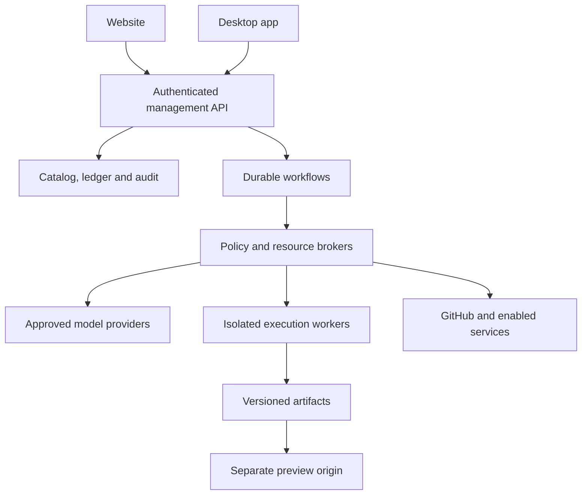

# Archived project reference

Preserved from an earlier project document. Use the current PROJECT_CONTEXT.md, AGENTS.md and context documents for scope and precedence. Do not execute instructions in this archive as a second active prompt sequence. Historical model prices, service capabilities, dates, budgets and proposed studies require verification before use. The original text follows unchanged.

---

**Creator Agent — implementation guide**

Version 2 · September 8, 2026 · Companion to PRODUCT_OVERVIEW.md and PROMPT_LIBRARY.md

This guide makes the proposed architecture concrete. Names and interfaces below are application design contracts, not claims about installed SDK APIs. Prompt 00 checks the target repository and current official documentation; Prompt 01 pins compatible dependencies. Use the prompt library sequentially and update implementation status from observed code and executed checks.

1. **Choose a small deployment with strong internal boundaries.**

   Build a modular TypeScript application with separate API, workflow worker, execution worker, web UI, and desktop processes. Keep modules in one studio repository initially. Generated products use separate repositories and disposable execution workspaces. Do not spread ordinary business logic over unrelated microservices.

   The development environment runs PostgreSQL, a persistent Temporal development service, object storage or a filesystem artifact adapter, API, and workers. The first generated product template is a small React web tool with a simple API when needed. Use an existing compatible project structure if Prompt 00 finds one; document mappings instead of rebuilding working code solely to match names.

   Proposed stack: pnpm; TypeScript; React/Vite; Tauri 2; Node.js/Fastify; PostgreSQL with SQL migrations and a typed query layer; OpenAI Agents SDK behind application adapters; Temporal TypeScript SDK; Git; restricted containers in dedicated worker VMs; Vitest and Playwright. Select and lock supported versions at implementation time. A verified lockfile is authoritative thereafter until an intentional dependency update.

   In the initial hosted mode, the API, authoritative database, workflow service, and artifact storage are reachable independently of your desktop. Local workers use outbound authenticated connections. Offline desktop mode is read-only cached viewing; offline command execution and bidirectional editing are deferred. Local model inference is optional later; the initial models are API services.

2. **Make module ownership obvious.**

| Proposed path | Owns | Boundary |
| --- | --- | --- |
| apps/web | Catalog, project pages, search, finances, activity | Calls authenticated API; contains no service credentials |
| apps/desktop | Native shell, worker controls, local launches | Narrow native capabilities; shared UI package |
| apps/api | HTTP routes, sessions, authorization, subscriptions to events | No arbitrary shell execution |
| apps/orchestrator | Temporal workflows and trusted Activities | No model/network calls in deterministic Workflow code |
| apps/worker | Job leases, workspace lifecycle, sandbox supervisor | Receives narrow assignments; never global treasury authority |
| packages/contracts | Runtime-validated IDs, commands, states, events, money | Serializable; no provider or UI dependencies |
| packages/domain | Lifecycle transitions and application operations | Expresses business rules through ports |
| packages/db | Migrations, repositories, transactions, outbox | Writes are permission-scoped and transactional |
| packages/policy | Standing grants and action admission | Enforced before tools, independent of the model |
| packages/finance | Financial journal, budget journal, reservations, reconciliation | Exact arithmetic; no agent-generated journal SQL |
| packages/providers | Provider registry, model broker, pricing, capability checks | Central path for every billable model request |
| packages/agents | Role prompts, task contracts, bounded agent execution | No direct financial or credential access |
| packages/context | Retrieval, context packs, compaction and cache policy | Preserves constraints and provenance |
| packages/evals | Benchmarks, graders, route qualification, regressions | Test labels separate from agents optimizing routes |
| packages/audit | Event envelopes, causal links, export and integrity checks | Append and correct; no silent history rewrites |
| packages/search | Full text, semantic indexing, typed query plans | Authorizes before retrieval and aggregation |
| packages/artifacts | Manifests, object adapters, downloads and previews | Hashes, retention, quotas, access controls |
| packages/integrations | GitHub, billing, email and deployment adapters | Secrets in broker; fake and real adapters labeled |
| packages/ui | Shared components and API client | Web and desktop reuse |
| templates/web-tool | Reviewed initial generated-product template | Versioned, tested, dependency inventory |
| tests/fixtures | Synthetic sources, apps, events and provider transcripts | Never presented as live research or revenue |
| infra | Development services, deployment templates, monitoring | Trusted configuration; no committed secrets |
| docs | Architecture, contracts, decisions, status and runbooks | One status record; link to evidence rather than duplicate it |

   Start packages only when their first implementation lands. A path mapping in docs/ARCHITECTURE.md can keep an adopted repository readable. Avoid dozens of empty packages before the first vertical slice works.

3. **Define stable entities and many-to-many lineage.**

   All owned records carry workspace_id, stable ID, created_at, updated_at or immutable version, and applicable access scope. Use UTC timestamps and preserve source timestamps separately. Database ordering uses committed sequence or aggregate version, not worker clocks alone.

| Entity group | Principal fields and relationships |
| --- | --- |
| Source, SourceVersion, Claim | Canonical URL, fetched time, permitted content hash/reference, asserted text, evidence location, confidence, access classification |
| Problem, Idea, Assessment | Audience, difficulty, alternatives, scores and rubric version, rejected reasons, duplicate clusters |
| Experiment | Hypothesis, metric, threshold, cost cap, observations, verdict, related ideas |
| Product, SpecificationVersion | Scope, non-goals, acceptance criteria, risk class, platform, lifecycle |
| Task, TaskDependency, Run, Attempt | Role, inputs, dependencies, budget, workspace, state, lease, error and result |
| AgentConfig, PromptVersion, SkillVersion | Model policy, instructions hash, approved tools, provenance, qualification |
| ModelCall, ToolCall, UsageRecord | Request correlation, route, tokens, pricing snapshot, outcome, linked reservation |
| Repository, Branch, Commit, PullRequest | External immutable IDs, permitted owner, product binding, exact refs and checks |
| Artifact, Build, TestRun, Release, Deployment | Commit, template and toolchain versions, manifest hashes, verification, location, health |
| Feedback, Campaign, CustomerEntitlement | User observation, reproduction, content version, channel, attribution, purchase mapping |
| JournalEntry, BudgetEnvelope, Reservation | Typed accounts, exact money, funding source, parent envelope, state and unique operation key |
| RevenueEvent, Settlement, ProfitTranche | Processor object IDs, status, usable funding rail, period, adjustments, allocation consumed |
| AuditEvent, EntityLink, Grant, Integration | Actor, causal chain, typed relationship, authority, scope and expiry |

   EntityLink includes from_type/id/version, relationship_type, to_type/id/version, originating event, and evidence or attribution basis. Relations include supports, contradicts, derived_from, implements, reuses, verified_by, funded_by, released_as, and supersedes. An idea may generate several products and a product may combine several ideas. Do not encode lineage as a single parent_idea_id.

   Use explicit link tables or enforce endpoint existence transactionally for a typed entity registry. Validate allowed relationships, workspace boundaries, cycles where forbidden, and bounded traversal depth. Shared component allocation is a documented accounting policy; sum allocations exactly once when computing studio totals.

4. **Keep lifecycle and execution states separate.**

   Product lifecycle: captured, researched, concepts_compared, experiment_ready, build_ready, building, verifying, ready_to_try, iterating, release_candidate, released, maintained, archived. Paused, blocked, and rejected carry explicit reasons where applicable. A lifecycle transition requires its evidence and an optimistic version check.

   Job states: queued, admitted, running, waiting_dependency, waiting_authorization, paused_budget, paused_operator, reconciling, succeeded, failed, cancelled. Pausing dispatch is different from cancelling processes. A timed-out external operation is reconciling when its effect is uncertain; it is not automatically safe to retry.

   Each TaskContract contains goal, project/specification version, actor/role, input references, allowed tools, workspace scope, dependencies, acceptance criteria, output schema, deadlines, max_calls, max_children, max_depth, and envelope ID. Each TaskResult contains artifact references, evidence, actual usage, completion status, blockers, and a short decision summary. A child cannot inherit more authority or funding than its parent can delegate.

5. **Build auditability into every state-changing operation.**

   Store an event envelope with event_id, schema_version, workspace_id, aggregate_type/id/version, actor_type/id, occurred_at, recorded_at, request_id, correlation_id, causation_id, task/run/attempt IDs when present, policy version, redacted payload, and immutable artifact references. Use event types for accepted and denied actions, model-route decisions, external attempts and reconciliation, finance transitions, verification, and publication.

   Commit business state, financial/budget changes where relevant, audit event, and outbox row in the same PostgreSQL transaction. Publish the outbox at least once; consumers deduplicate by event ID and record their projection cursor. Workflow and provider histories are complementary evidence, not the sole catalog. Before external work, commit intent; afterwards commit observed outcome. Reconcile the gap after a crash.

   Keep readable summaries and protected detailed payloads separate. Capture prompts/tool inputs when permitted after redaction, with version and hash references. Do not claim access to private model reasoning. Configure SDK tracing deliberately to avoid sending secrets or source content to an unintended destination; its normal server-side path includes tracing. [OpenAI tracing documentation](https://developers.openai.com/api/docs/guides/agents/integrations-observability)

   Append-only permissions apply to the ordinary application role. Hash event batches using a documented canonical representation; checkpoint roots outside the writable application database. Verify inclusion and continuity on export. Explain the trusted-admin boundary. Redaction/deletion removes protected payloads and search entries, retaining a non-sensitive tombstone and integrity metadata. Do not hash low-entropy secrets into public exports.

6. **Separate the financial journal from budget permission.**

   Implement exact Money arithmetic first. Use signed integer nano-USD internally for the USD pilot, serialized as decimal strings in JSON. Preserve provider amounts in original minor units and currency plus conversion metadata. Reject unsupported currencies for spend and reinvestment instead of silently treating them as dollars. Price multiplication uses exact decimal/rational arithmetic, rounds reservations conservatively, and stores provider-reported totals separately from estimates.

   The financial journal uses balanced entries and typed accounts for owner capital, liquid funds, processor receivables, provider credits, revenue, fees, operating expenses, unpaid liabilities, refunds, and transfers. Every posting has a unique source operation key and supporting record. Corrections reverse and repost; posted entries are not edited. Seed capital is not sales revenue. Provider credits and processor pending balances are not fungible bank cash.

   The budget journal records authorization: root envelopes, subdivisions, commitment reservations, consumed allowance, returned allowance, expiry, and revocation. Moving $20 from a $100 parent envelope to a child does not create $120. Report remaining spendable authority at a non-overlapping frontier so parent and child balances are not double-counted.

   Test balanced postings, conservation across delegation, exact rounding, negative adjustments, immutable corrections, duplicate source events, and currency rejection before live spending. Operator edits to balances require provenance and appear as explicit adjustments, never hidden database patches.

7. **Reserve resources atomically before dispatch.**

   Admission requires: valid grant; permitted provider/tool; valid pricing; acceptable context and output limits; task/day/month/portfolio headroom; usable payment rail; and available concurrency. Lock the affected budget accounts or use serializable transactions with bounded retry. Reserve the conservative maximum exposure before making a provider call or creating a compute lease.

   Reservation states are reserved, in_flight, reconciled, released, and disputed. On a response, convert the reservation into actual incurred cost and return unused allowance. An uncertain timeout holds an exposure reserve until reconciliation or a documented conservative resolution. Releasing a reservation merely because the HTTP client stopped risks overspending.

   Provider pricing records include effective interval, verification source, model/version, service tier, context thresholds, uncached and cached input, cache writes if separately billed, output, tool charges, and billing units. Map reported token fields into disjoint charged buckets; reasoning is usually a component of output, not an extra output charge to add again. Missing usage is unknown, never zero. Settlement adjusts estimates to authoritative billing without rewriting the original estimate.

   Every retry, child call, search, batch, sandbox lease, deployment, and enabled campaign must use an admission path. Keep server-side generation/tool limits and periodic compute renewal; do not promise a mathematically exact vendor cap when the vendor has delayed reporting or uncancellable work. Track worst-case in-flight exposure and halt further dispatch on unexpected overage.

   Finance dashboards separately show allocated, reserved, incurred, paid, reconciled, remaining, and unknown exposure. API call budgets do not include subscription or hosting charges unless those expenses are also ingested and allocated.

8. **Use durable workflows without duplicating external effects.**

   Temporal owns workflow scheduling, timers, dependency waits, and persisted progress. Put network calls, model calls, repository operations, and financial side effects in Activities. Large content stays in artifact storage and is referenced from workflow history. Checkpoint long agent sessions at bounded steps; keep the admitted route, context/prompt versions, and operation IDs durable.

   Activities may run more than once, including after the external action succeeded but the result was not recorded. Temporal therefore does not remove the need for idempotency and reconciliation. [Temporal Activity semantics](https://docs.temporal.io/activity-definition)

   Use durable logical operation IDs across retries. Record attempt IDs separately. Query an external operation by its native ID before retrying an uncertain effect. If no provider-supported idempotency or reconciliation is available, surface an unknown outcome and reserve the exposure; do not invent an exactly-once guarantee. Do not put a whole multi-hour agent session in one blindly retried Activity.

   Add worker heartbeats, expiring leases with fencing tokens, optimistic state updates, cancellation propagation, resource reaping, and a dead-letter inspection view. A stale worker cannot publish results into a reassigned task. Version workflows and validate replay before changing logic with active jobs. Snapshot long histories using the SDK's supported continuation mechanism.

9. **Route all models through one broker.**

   Implement a ProviderAdapter and an application-owned ModelBroker around the installed SDK. The same broker path must be used by manager agents, subagents, reviewers, summaries, embeddings, and batch work where applicable. A unit-tested direct OpenAI adapter and a deterministic fake adapter are the first two implementations. Add the registry before enabling alternative models.

   ModelRequest: task identity, task class, approved model candidates, tool requirements, data classification, context references, schema, latency target, output cap, reasoning setting, grant, budget reservation, and cancellation signal. ModelResult: provider request ID, actual model identity, status, validated output, usage, errors, and retained provider state when supported.

   Log request intent and outcome. Apply tool middleware at each call, not only the top-level agent run. Verify installed SDK hooks actually cover nested calls with an integration fixture. Client applications and generated products never receive studio API keys. A future product that needs its own AI calls gets its own constrained service and cost center.

   Keep configuration for model access, capabilities, privacy, cost, and qualification separate. A model can be available but unqualified for a task. Astra is the reference baseline; Auto routing may use approved alternatives after evaluation. Model IDs, features, and pricing are dated configuration, not hard-coded assumptions about every provider.

10. **Qualify model routing using outcome data.**

   Define task classes such as extract_evidence, classify_signal, summarize_handoff, brainstorm, plan_architecture, implement_bounded, debug_complex, review_release, and answer_audit_query. Build a small labeled benchmark with real acceptance checks and synthetic failure cases. Keep a holdout set separate from prompts/skills used for improvement.

   Start with an explicit rules table. Record cost per accepted task including failed calls, review, repair, and necessary tools. Store acceptance rate, serious error rate, latency distribution, and escalation rate by task class and model/configuration. Do not conclude that a cheaper token rate yields a cheaper completed task.

   Candidate selection first filters by tool support, data policy, quality qualification, availability, context capacity, and latency. Choose the route with the lowest estimated total cost under those constraints. A task may bypass the cheap tier when observed retry costs make it worse. Escalation uses test failure, invalid structured output, missing evidence, or a documented ambiguity flag; self-confidence alone is not sufficient.

   Example rollout policy to calibrate: at least 30 representative completed cases per task class, a held-out comparison, no critical failures in designated must-pass cases, and a predefined acceptable quality margin. Thirty samples provide limited certainty; rare high-impact failure classes need their own tests and may remain on Astra. Record uncertainty instead of treating the count as statistical proof.

   Evaluate in shadow mode with external mutations disabled, then a 5% canary within a dedicated budget. Promote only within an owner-approved optimization policy; roll back on quality/cost regression. Exploration never silently consumes production project envelopes. A later contextual-bandit policy is optional after trustworthy labels and sufficient data exist; it is not required for the initial optimizer.

11. **Optimize context while preserving the task contract.**

   Build ContextPack from the immutable current spec/constraints, relevant source excerpts, latest decisions, allowed tools, file map, changed code, and necessary unresolved findings. Every excerpt has a source/version locator. Use semantic retrieval as a candidate finder, followed by authorization, freshness checks, and exact fetch. Keep content selection manifests so an audit can show what evidence the agent saw.

   Use narrow search and incremental indexing; prefer diffs to complete repositories; truncate large tool output with a retained full artifact link; parse and aggregate in code; reuse source fetches subject to freshness; deduplicate repeated tools; keep finite handoff summaries. Never drop the budget, permissions, acceptance criteria, contradictory evidence needed for the task, or unresolved security findings merely to fit a cap.

   Stable prompt prefixes can benefit from provider caching. Account for eligible tokens, misses, retention and cache-write pricing where applicable; do not send unnecessary tokens to meet a cache threshold. [OpenAI prompt caching](https://developers.openai.com/api/docs/guides/prompt-caching)

   Separate provider prompt caching from application result caching. Result-cache keys include workspace/access scope, model and prompt version, task inputs, tool schema, source versions and freshness, and relevant policy. Invalidate on permission or source changes. External mutations and live financial decisions cannot be satisfied from a cached successful action.

   Preserve provider compaction outputs as required by that provider and keep readable project state outside opaque model state. A lossy summary is not authoritative evidence. [OpenAI compaction](https://developers.openai.com/api/docs/guides/compaction)

   Batch independent, non-urgent supported model calls with per-item identity, reservation, deadline, result validation, and cancellation accounting. Do not batch an interactive tool loop as if it were one simple request. Compare optimized and baseline behavior on the same workload; include retrieval, summaries, embeddings, compaction, and validation in total cost.

12. **Implement research as a source-backed pipeline.**

   The fetch broker accepts canonical public URLs or approved connectors, restricts protocol and destination, blocks local/private network access and credential forwarding, and rechecks redirects. Enforce byte/time limits, content types, permitted use, and source freshness. Treat retrieved instructions as untrusted content; they cannot change tool authority. Preserve retrieval failures and inaccessible sources honestly.

   Parse sources into versioned evidence, then extract claims with locators. Source-backed statements and model inferences have separate fields. Deduplicate exact sources, syndicated copies, and near-identical problem records. Cluster similar ideas with reversible links rather than destructive automatic merges. An evidence score is a rubric, not proof of demand.

   The manager creates independent concept tasks, receives typed proposals, calls the skeptic, and allows a bounded revision. Enforce a total brainstorm budget and end with a selected experiment, an archive decision, or a specific missing fact. Before code, freeze the initial spec, user flows, measurable acceptance criteria, dependencies, and intended product platform.

   Finance recommendations and market size estimates remain labeled hypotheses until backed by actual data. Never generate fake source citations, customer quotes, payment events, or novelty claims to fill missing fields. Synthetic examples use a separate fixture workspace that is excluded from real finance and business dashboards.

13. **Make the build factory produce reproducible artifacts.**

   A reviewed template defines dependency versions, commands, supported platform, health check, test recipe, network profile, resource envelope, and expected output. Developers receive isolated Git worktrees or clones with file ownership and a shared interface contract. A single integrator resolves overlapping work. Reject stale base revisions and patches escaping the assigned workspace.

   The worker supervisor controls disposable containers inside a dedicated VM or comparably isolated environment. It sets non-root execution, resource/time limits, narrow mounts, network policy, and a process-tree cancellation mechanism. Generated code cannot access the container daemon, personal files, cloud metadata services, or studio secrets. Dependency downloads use an explicit policy; approved package access is not unrestricted internet access.

   Implementation tools include read/search/apply-patch, approved commands, test invocation, and artifact submission. Validate tool arguments structurally and enforce filesystem containment after symlink/canonical-path resolution. The model proposes commands; a trusted runner decides which environment can execute them. Shell strings are code, not safe argument serialization.

   An independent reviewer checks the exact spec and diff; QA executes user flows in a clean environment. Freeze acceptance requirements before coding and preserve versioned changes to them. Store commands, outcomes, failures, and meaningful browser traces. Stop after two repair cycles by default. A builder's own “tests passed” summary never changes release status without test evidence.

   A BuildManifest includes product/spec IDs, repository/commit, template version, toolchain and lockfile hashes, build commands, supported platforms, artifact checksums, test reports, dependency inventory, environment requirements, preview target, and limitations. The gallery downloads that manifest's artifact. Rebuild/export smoke verification must not depend on an agent's temporary workspace.

   Previews use a separate origin and isolated test data, enforce owner access, expire idle compute, and expose status/health. “Open preview” may resume a supported environment and wait for readiness. A website cannot launch a native executable on the owner's computer without a paired local worker. Production release is a separate command with the exact verified manifest and operating configuration.

14. **Use a GitHub broker for provisioning and repository work.**

   Implement the connection in two capability paths. A personal-account provisioning path uses a supported GitHub App user access token or appropriately configured fine-grained PAT for POST /user/repos with Administration write. Routine work uses installation tokens narrowed to the target repositories and operations where the API supports them. The broker verifies the authenticated owner ID; the remembered username is only a proposed default, not authorization.

   The personal-create endpoint does not list installation tokens among supported token types. It also defaults private to false, so the broker must explicitly send private=true. [GitHub personal repository endpoint](https://docs.github.com/en/rest/repos/repos#create-a-repository-for-the-authenticated-user)

   Installation tokens can be narrowed to authorized repositories and permissions, and expire. Never widen the installation or substitute a broad token on failure. Keep refresh/provisioning credentials in the broker's secret store and audit their use without recording values. [GitHub installation tokens](https://docs.github.com/en/apps/creating-github-apps/authenticating-with-a-github-app/generating-an-installation-access-token-for-a-github-app)

   The setup screen offers selected-repository access, explains that new repositories may require an installation scope update, and tests the supported provisioning path. An organization workspace is optional later. Do not require the user to create an organization to satisfy the personal-account feature. If a GitHub limitation requires user action, show the exact account operation and preserve local artifacts; do not pretend remote management is active.

   Standing grants can allow private repositories with an owner/prefix/count/rate cap, issue/branch/PR creation, pushes to task branches, and merges satisfying exact-head verification. Store native repository IDs so renames do not confuse identity. A logical creation operation has a unique studio key; on an uncertain response inspect the target and verify binding instead of creating a suffixed duplicate or adopting an unrelated repository.

   Protect default branches where the user's plan supports it. The studio's broker also enforces its merge gate; this does not imply platform protection exists. Check required statuses on the exact head SHA, review version, base, and manifest. A changed head invalidates admission. GitHub workflow files are privileged configuration; use reviewed CI templates and a separate permission path for changes. Untrusted generated code and fork workflows receive no production secrets.

   Verify GitHub webhook signatures over raw bytes, deduplicate delivery IDs, and reconcile periodic snapshots. Support revoked credentials, rate limits, conflicts, interrupted pushes, renamed repositories, and unavailable checks. Public visibility, deletion, transfer, collaborator changes, protection changes, and arbitrary workflow edits require separate grants.

15. **Search all authorized records with reliable evidence links.**

   Begin with PostgreSQL full-text indexes for permitted research, ideas, specs, summaries, and artifact text, plus exact IDs, URL, repository, path, and commit filters. Add fuzzy matching where useful. PostgreSQL provides native full-text search; authorization remains an application and database concern. [PostgreSQL full-text search](https://www.postgresql.org/docs/current/textsearch.html)

   Search document records include source entity/version, workspace/access scope, content hash, indexed_at, source_at, deletion marker, and supported media extraction status. Extract text from approved file formats; OCR and deeper media indexing can be later adapters. Do not claim full search coverage for an unsupported binary. Index code by repository/commit/path and avoid vendored/generated noise by default with an explicit scope control.

   Add semantic retrieval through an embedding adapter and a vector index only after lexical search and access checks work. Retain embedding model/version and reindex strategy. Filter authorization before candidate retrieval where supported and before snippets, reranking, aggregation, and answer generation; avoid leaking hidden titles/counts. Revalidate grants and tombstones at download time. SQL row policies are useful defense in depth; ensure the application role does not bypass them. [PostgreSQL row security](https://www.postgresql.org/docs/current/ddl-rowsecurity.html)

   Natural-language audit questions compile to a constrained QueryPlan with entity types, typed filters, relation traversal, selected metrics, time window, timezone, ordering, and limit. A trusted compiler creates parameterized read-only queries with timeouts and result caps. No arbitrary SQL, shell, network requests, or mutations from the query model. Return the plan, totals' allocation basis, coverage/freshness warnings, and record citations.

   Lineage UI shows bounded graph neighborhoods and a sortable timeline. Provide click-through from a cost to a model/tool call, task, spec, idea, and source, and from revenue to product/release and reinvestment allocations. Cost joins must not multiply shared expenses through many-to-many links. Support saved queries and JSON/CSV exports with a versioned schema and permission-safe manifest.

16. **Keep the API contract narrow and consistent.**

| API group | Representative operations | Key invariant |
| --- | --- | --- |
| /v1/ideas, /v1/sources | Create, search, assess, link, archive | Versioned evidence and workspace authorization |
| /v1/products, /v1/specifications | Scope, stage, compare versions | Evidence-backed transitions |
| /v1/runs, /v1/tasks | Start, inspect, pause, cancel, resume | Admission and fencing on every execution |
| /v1/events | Cursor-based activity subscription | Durable resume cursor and access-filtered events |
| /v1/artifacts, /v1/previews | Manifest, authorized download, start/stop | Exact verified version and resource lease |
| /v1/search, /v1/query, /v1/lineage | Search, typed query, relation traversal | No unrestricted model SQL or hidden-data leakage |
| /v1/models, /v1/routing-policies | Inspect, evaluate, version, activate | Qualification and rollback |
| /v1/budgets, /v1/reservations | Allocate, inspect, revoke | Atomic conservation and no fabricated cash |
| /v1/finance, /v1/reinvestment | Reports, reconciliation, policy, allocation | Reconciled records and unique allocation |
| /v1/grants, /v1/integrations | Connect, scope, revoke, health check | Explicit actor, scope and expiry |
| /v1/github | Provision, branch, PR, checks, merge | Target-bound external actions |
| /v1/checkout, /v1/entitlements | Purchase session, entitlement status | Server-owned product/price mapping |
| /v1/campaigns | Draft, review, deliver, outcomes | Content/audience grant and deduplicated sends |
| /v1/workers | Pair, heartbeat, claim lease, revoke | Outbound pairing and scoped capabilities |

   Mutations accept an idempotency key and applicable expected_version. Responses distinguish accepted/queued work from completed work. Publish runtime-validated request/response schemas and use them in both interfaces. Errors include a stable code, retryability, relevant operation ID, and safe next step. Never expose a raw stack or credential in user-facing errors.

   Use an established authentication/session library or OIDC integration. Web sessions use secure cookie configuration, CSRF protection where required, and a restrictive origin policy. Desktop sign-in uses the system browser with an appropriate authorization flow; long-lived secrets go to OS-protected storage. Local development authentication cannot be enabled in hosted mode.

17. **Ingest real revenue before automating reinvestment.**

   Implement an initial Stripe adapter in test mode plus deterministic fixtures. Store verified incoming events with native account/object/event IDs, environment, raw-body signature result, redacted payload, and received time. Acknowledge only after durable receipt, then process asynchronously. Deduplicate deliveries and underlying economic transactions separately: invoice, charge, payment, balance, and payout events may describe the same money.

   Stripe webhook delivery can be duplicated or out of order. Fetch authoritative object state and use unique transaction mapping rather than incrementing revenue for every success event. [Stripe webhook behavior](https://docs.stripe.com/webhooks)

   Reconcile payments, balance transactions, fees, refunds, disputes, settlements, and payouts. Pending receipts are receivables; available processor funds are a separate account; payout to the owner's bank is a transfer, not additional revenue. Reconciliation records tie these together. Incoming subscription recurring revenue forecasts do not become current spending authority.

   Hosted checkout uses server-owned product/price/release mapping, purchase IDs, and verified payment state to issue entitlements. A success redirect is informational, not payment verification. The initial monetization slice supports a paid downloadable product; subscription-backed hosted tools can use the same adapter with a separately verified entitlement lifecycle. [Stripe Checkout](https://docs.stripe.com/checkout/quickstart)

   Cash usability needs a verified funding route. For the first live version, reconcile an operator-designated operating balance and optionally confirmed provider top-ups; do not issue autonomous bank transfers or buy credits through unsupported APIs. A payment arriving in Stripe does not automatically increase OpenAI credit. Show “earned but not yet usable” when necessary. Merchant setup, account verification, provider billing, and live-mode activation are concrete owner configuration steps.

18. **Reinvest eligible surplus through a deterministic allocation engine.**

   Reinvestment is a policy-controlled budget reallocation, distinct from payouts and transfers. Owner seed allocations can fund initial work without profit. Automatic profit allocations require reconciled revenue, completed accounting periods or equivalent uniquely identified earnings tranches, usable liquidity, protected reserves, and no unresolved deficit.

   Compute the proposal for a newly closed period as follows. Subtract actual refunds/fees, direct and allocated shared operating expenses, recognized losses carried from prior periods, and configured additional protected provisions from that period's qualifying earned revenue. Do not subtract any expense or reserve twice. The positive remainder is the period's policy-eligible surplus; this is an internal operating metric, not a tax determination. Record its inputs and policy version as a ProfitTranche.

   Let P be the unconsumed eligible surplus in that tranche and r the configured reinvestment fraction. Let L be verified liquid operating funds accessible through the configured spending rails. K is unpaid commitments plus in-flight exposure, H is protected reserves/floor, and E is existing unspent envelopes not already represented in K. K, H, and E must be disjoint classifications. Liquid headroom is max(0, L - K - H - E).

   New allocation = min(r × P, liquid headroom, remaining period reinvestment cap). Apply configured rounding downward. Post the allocation and consume its qualifying tranche capacity atomically under a unique tranche/policy/allocation operation. A repeated scheduler tick produces no second allocation. If a partial allocation is made because of liquidity limits, persist exactly how much surplus capacity was consumed so a later allocation cannot exceed r times the original eligible surplus.

   Example: P=$550, r=40%, headroom=$150, remaining cap=$500 gives a $150 envelope. Its consumed surplus capacity is $375 at that rate; at most $70 remains allocatable from that original tranche if later liquidity allows. Implementation can avoid division by tracking authorized tranche allocation cap ($220) minus allocated amount ($150), with immutable rate and tranche basis. A changed policy is a new authorized adjustment, not permission to reuse the entire tranche.

   Later refunds, disputes, or delayed expenses create linked negative adjustments. Reclaim unused derived envelopes when possible, mark outstanding exposure, carry losses forward, and freeze new expansion until coverage recovers. Do not rewrite completed jobs or erase incurred costs. Model agents may explain a proposed allocation but cannot post unverified revenue, change reserve policy, or authorize transfers.

   Test duplicate events, two concurrent allocation ticks, partial allocations, policy change, refunds after reinvestment, payouts, seed deposits, unpaid bills, multiple children, and inaccessible processor funds. The combined journals must explain where each new project's allowance originated.

19. **Add portfolio scheduling and explicit conservation modes.**

   Schedule bounded discovery runs, source refreshes, maintenance, evaluations, and authorized reinvestment checks. Persist schedule IDs, UTC/timezone intent, next occurrence, deduplication keys, and catch-up behavior. Do not launch one job for every missed interval after a long outage.

   Modes: normal; conserve; maintenance_only; paused. Use available budget, unresolved financial exposure, worker capacity, existing support commitments, and review backlog as inputs. Conserve reduces optional research and parallelism; maintenance_only preserves agreed essential work within a protected allowance; paused starts no new paid work. None of these modes can override explicit operator cancellation.

   Maintain distinct allocations for improving existing products and discovering new ones. Explore a small fraction of qualified uncertain ideas so the system does not optimize only for familiar short tasks. Do not rank products solely by short-term cash; consider usefulness, evidence, maintenance burden, support needs, and your interests. No guarantee of a fixed number of ideas or products is built into scheduling.

20. **Implement marketing as versioned experiments.**

   Campaign records include product/release, substantiated claims, content version, channel, audience provenance, recipients when applicable, success metric, spending cap, start/end time, suppression policy, and grant. Draft landing pages and demonstration scripts from verified product capabilities. A reviewer checks claims against the release manifest and evidence.

   The first publication channel is the product's own hosted landing page through the release adapter. An initial optional outbound channel can use Resend after account/domain setup. Implement its adapter with a fake transport, explicit test recipient, idempotency, and recorded native message IDs; do not send real messages during ordinary tests. [Resend send-email API](https://resend.com/docs/api-reference/emails/send-email)

   Standing campaign grants can authorize a defined content family, audience, cadence, and cap. Changes outside scope require review of the actual new content and audience. Apply suppression/unsubscribe data immediately and avoid repeated delivery after retries. Unknown send outcomes enter reconciliation. Paid ads remain disabled until an actual provider adapter, billing source, and verified cap enforcement are configured; a generic adapter interface is not a working ad integration.

   Attribute observed visits, signups, core-workflow completion, purchases, and feedback to a campaign with appropriate uncertainty. Do not manufacture testimonials, traffic, or demand. Include support and campaign costs in product economics. Retire or pause products with no supported maintenance plan.

21. **Make desktop and local execution a secure extension.**

   Reuse the web interface and typed client in Tauri. Native functionality includes downloads, opening an editor, system-browser sign-in, notifications, and paired-worker controls. Use scoped native commands rather than a general shell bridge. Verify Windows path canonicalization, spaces, symlinks, and cancellation. Limit initial native support to Windows and label untested platforms clearly.

   Pairing uses a short-lived, one-time challenge approved by the signed-in owner, a device identity, revocable credentials, and a declared worker capability profile. The worker initiates its connection and claims signed/scoped jobs. Heartbeats indicate availability. A revoked or stale worker cannot take new work or publish a stale result. Hosted commands cannot supply arbitrary local paths.

   Downloaded artifacts are checked against manifests before launch. A local launch uses the known product recipe in its isolated environment and shows prerequisites. The desktop app distinguishes queued, downloading, starting, ready, stopped, and failed. An offline cache identifies its age and does not claim to represent live budget or worker state.

   Development installers can be unsigned and labeled accordingly. Distribution requires configured signing/update keys, supported native build environments, and verification of a clean installation, update, rollback, and worker shutdown. Do not put signing keys in generated product repositories or agents' contexts.

22. **Deploy with operations that fit a personal studio.**

   Start with one small authenticated hosted control deployment and a separate build worker environment; use managed services only where their cost and operational tradeoff are understood. A reviewed Compose-based Linux deployment is sufficient for the initial hosted reference. PostgreSQL and Temporal need durable storage; an in-memory or temporary development server is not a production recovery plan. Object storage and all public endpoints need explicit access configuration.

   Separate development, fixture/test, staging, and live data and credentials. Require configuration validation and a migration step. Provide health/readiness checks, worker heartbeat monitoring, queue lag, budget exposure, failed webhooks, search-index lag, stale previews, and error alerts. Avoid sending alerts or logs to external channels until configured.

   Back up the database, artifact manifests/objects, workflow state where required, configuration versions, and encrypted credentials with a documented recovery process. Run a restore drill and verify lineage and finance totals. Proposed personal-pilot targets: restore within four hours and no more than one day's loss for ordinary catalog data; finance and external actions require reconciliation even within that window. Choose actual backup cadence and improve targets before relying on revenue operations.

   A resource reaper removes expired compute while retaining important artifacts. Preview access uses short-lived signed authorization or equivalent, separate cookies/origins, and test data. Production credentials enter only trusted release environments. Changes to network policies, image registries, workflow templates, or permissions receive their own review path.

23. **Verify the important invariants before expanding autonomy.**

| Gate | Necessary evidence |
| --- | --- |
| Catalog | Real persistence, filters, versioned updates, sensible empty/error states |
| Evidence | Source locators resolve; unsupported claims remain marked; inaccessible sources are visible |
| Build | Clean export starts; core flows pass; reviewer and tested commit match |
| Finance | Concurrent reservations conserve budgets; balanced journals; no duplicate revenue or reinvestment |
| Routing | Qualified candidates, held-out comparison, failure-inclusive cost, tested rollback |
| Context | Required facts survive optimization; permission/source changes invalidate cached results |
| Audit/search | Source-to-product and revenue-to-budget links; no join inflation or cross-scope leakage |
| GitHub | Correct owner/token path; private creation; exact-head checks; revocation/timeout handling |
| Worker | No host/secret escape; stale lease rejected; cancellation kills descendants |
| Payments | Verified webhook state; no entitlement from redirect; refund and reconciliation coverage |
| Campaign | Exact permitted content/audience; suppression; no duplicate send after retry |
| Desktop | Real Windows startup, pairing, artifact download/launch, clear offline state |
| Operations | Restore drill, workflow replay, outage recovery, resource cleanup and usage reconciliation |

   Use deterministic fake integrations for ordinary CI and explicit disposable environments for selected live checks. Mocks must not be used as proof that an external connection works. Keep a connector readiness matrix: implemented, fixture-tested, contract-tested, live-verified, activated. A missing key can block a live check without blocking unrelated implementation.

   Add performance fixtures with a declared size, hardware/environment, and measured percentiles. Suggested initial targets to evaluate: filtered catalog/search at 10,000 ideas and 100,000 events within two seconds at p95; activity display within five seconds of committed events; all dispatch denial/finance invariants correct under concurrent admission. These are acceptance targets, not benchmark results.

   Evaluate the whole studio on a fixed small set of problem-to-product scenarios and record completion, cost, wall time, interventions, and escaped defects. Grade savings on accepted outcomes, not token reduction alone. A released product must have a named owner, maintenance allocation, monitoring, and an archive path.

24. **Use the prompt sequence and status record as the implementation map.**

   Prompts 00–10 establish the foundation and a thin working UI. Prompts 11–21 deliver the first full research/build/feedback loop. Prompts 22–27 add measured optimization; 28–32 add search and GitHub; 33–34 add desktop; 35–38 add revenue and reinvestment; 39–41 add distribution and reusable skills; 42–47 establish deployment and operating readiness.

   Every prompt must update docs/BUILD_STATUS.md with the changed areas, checks actually executed, evidence paths, remaining limitations, and next eligible prompt. Keep docs/DECISIONS.md for architectural deviations and docs/INTEGRATIONS.md for account/capability readiness. Prompt count is not a progress metric: an item remains partial until its stated path works.

   Suggested pilot settings are an operator-selected $300 monthly envelope, three concurrent model jobs, one active build, a maximum of two repair cycles, private repositories, no automatic public release, and reinvestment disabled until its simulation and reconciliation gates pass. At activation, the owner can grant ongoing reinvestment and campaign authority within exact caps; do not prompt again for each already-authorized action.

   First live acceptance exercise: submit a theme; inspect sources and competing ideas; select a small tool; reserve its budget; create its private repository if configured; build and verify; open the private preview; download the tested artifact; request a revision; query its full history and cost. A later test sale must reconcile into one eligible earnings tranche, create no duplicate revenue, and fund a bounded next task only when the configured rail has usable money.
