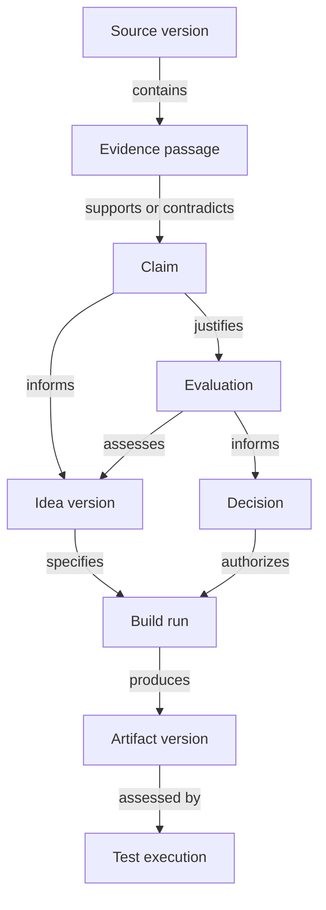

# Archived project reference

Preserved from an earlier project document. Use the current PROJECT_CONTEXT.md, AGENTS.md and context documents for scope and precedence. Do not execute instructions in this archive as a second active prompt sequence. Historical model prices, service capabilities, dates, budgets and proposed studies require verification before use. The original text follows unchanged.

---

# Creator Agent: Research Foundations and Design Guide

Prepared for Jordan Price · University of Florida honors thesis · 29 September 2026

## Purpose and scope

This guide organizes credible sources for identifying worthwhile problems, evaluating ideas and software interventions, ranking alternatives, checking evidence, and maintaining searchable records of how ideas become products. It is aligned with your current project overview and committee meeting guide: the main research question concerns whether structured, evidence-based discovery produces more useful, feasible, and well-supported software ideas than open-ended generation.

The bibliography favors original research, official standards, government methods, and documentation maintained by the relevant organization. These types serve different purposes: a standard specifies a model; a research study supplies findings under particular conditions; a practitioner guide supplies a process. None alone validates Creator Agent. This is a curated research guide, not an exhaustive systematic review. Publisher records, abstracts, official pages, and accessible text were checked. Access limitations are identified where material could not be inspected in full. Dynamic documentation should be captured by version when implemented.

Recommendations labeled **Proposed application** are my synthesis for your project. They are not algorithms or validated scores copied from the cited sources. Source identifiers S01–S35 refer to the annotated bibliography below.

## Start with these readings

| Order | Source | What to extract for Creator Agent |
|---|---|---|
| 1 | S01: GOV.UK discovery guidance | A problem brief grounded in users, their existing workflow, and constraints. |
| 2 | S05: DARPA Heilmeier Catechism | A short set of questions every candidate must answer before selection. |
| 3 | S12–S13: Google PAIR and the Magenta Book | A causal explanation of how software could change a measurable outcome; a separate justification for AI. |
| 4 | S09–S11: NASA and multi-criteria decision analysis | Explicit alternatives, measurable criteria, tradeoffs, and sensitivity to uncertainty. |
| 5 | S14: Si, Yang, and Hashimoto | Research closest to your thesis: human evaluation of AI-generated ideas and limits of self-evaluation. |
| 6 | S16, S19–S20: lateral reading, Crossref, ALCE | Source verification, publication-status checks, and citation-support evaluation. |
| 7 | S21–S22: W3C PROV and FAIR | Stable identifiers, versioned records, and traceable relationships. |
| 8 | S35: Hevner and colleagues | How to frame building and evaluating the system as a research contribution. |

## Annotated sources

### A. Finding real problems and determining relevance

**S01. Government Digital Service. “How the discovery phase works.” Service Manual (2016; updated 2021).**

- **Type and access:** Official government service-design guidance; public full text.
- **Link:** [GOV.UK discovery guidance](https://www.gov.uk/service-manual/agile-delivery/how-the-discovery-phase-works).
- **Contribution:** Explains how to investigate users, their context, constraints, existing services, and potential improvements before committing to development. Discovery can reasonably end with a decision to stop.
- **Proposed application:** Require a named affected group, a concrete task, observed difficulty, current workaround, and a reason an intervention is worth investigating.
- **Limit:** A useful operational method, not an experiment establishing that any particular discovery process guarantees successful products.

**S02. National Science Foundation. NSF I-Corps: About Teams and National Teams Applicants.**

- **Type and access:** Official research-commercialization program guidance; public.
- **Links:** [About Teams](https://www.nsf.gov/funding/initiatives/i-corps/about-teams) · [National Teams Applicants](https://www.nsf.gov/funding/initiatives/i-corps/national-teams-applicants).
- **Contribution:** Centers customer discovery on contact with potential customers, partners, and stakeholders.
- **Proposed application:** Separate desk-research hypotheses from evidence collected from actual users, purchasers, maintainers, and adoption decision-makers. Ask about recent behavior and workarounds, then investigate whether the proposed change fits their setting.
- **Limit:** A model simulating an interview is not customer evidence. NSF’s program interview requirements are specific to that program, not a sample-size rule for your thesis.

**S03. Design Council. Framework for Innovation / The Double Diamond.**

- **Type and access:** Original institutional design framework; official pages indexed, direct retrieval was intermittent.
- **Links:** [Framework for Innovation](https://www.designcouncil.org.uk/resources/framework-for-innovation/) · [History of the Double Diamond](https://www.designcouncil.org.uk/resources/the-double-diamond/history-of-the-double-diamond/).
- **Contribution:** Organizes exploration and narrowing into Discover, Define, Develop, and Deliver.
- **Proposed application:** Give the locator time to identify different problem framings before selecting one. Generate different solution mechanisms only after defining the problem.
- **Limit:** The stages are a process aid; real investigation is iterative. The framework does not prove that separate AI agents are required for each stage.

**S04. National Academy of Engineering. Grand Challenges for Engineering; related undergraduate workshop proceedings (2018).**

- **Type and access:** Official engineering priority framework and National Academies proceedings.
- **Links:** [Grand Challenges project](https://www.nae.edu/20782/grand-challenges-project) · [Open workshop proceedings](https://www.nationalacademies.org/read/25018), DOI [10.17226/25018](https://doi.org/10.17226/25018).
- **Contribution:** Provides broad themes including personalized learning, health informatics, cybersecurity, and tools for scientific discovery.
- **Proposed application:** Use these as search seeds consistent with Professor Dorley’s advice, then narrow to an affected group, bottleneck, and outcome.
- **Limit:** Inclusion in a Grand Challenge does not establish current local urgency, unmet demand, or software feasibility. The main NAE page could not be fetched directly; its indexed record and the accessible official proceedings corroborate the framework.

### B. Idea strength, novelty, and ranking alternatives

**S05. DARPA. The Heilmeier Catechism.**

- **Type and access:** Official research-program evaluation questions; public full text.
- **Link:** [The Heilmeier Catechism](https://www.darpa.mil/about/heilmeier-catechism).
- **Contribution:** Prompts a clear objective, comparison with current practice, a proposed advance, significance, risks, resource requirements, and tests of progress.
- **Proposed application:** Turn the questions into a required idea-card schema. An agent should be able to explain the proposal in ordinary language and identify what evidence would show success.
- **Limit:** This is a proposal-screening framework, not a numeric predictor of success.

**S06. Runco, M. A., and Jaeger, G. J. (2012). “The Standard Definition of Creativity.” Creativity Research Journal, 24(1), 92–96.**

- **Type and access:** Peer-reviewed conceptual article; publisher metadata and indexed text verified; direct full-page access was restricted.
- **Link:** [DOI: 10.1080/10400419.2012.650092](https://doi.org/10.1080/10400419.2012.650092).
- **Contribution:** Treats creativity as requiring originality and effectiveness.
- **Proposed application:** Evaluate whether an idea differs meaningfully from alternatives and whether that difference serves the intended purpose.
- **Limit:** A creative idea can still be impractical, unwanted, or harmful. This definition supplies neither a market-demand test nor a complete ranking rubric.

**S07. Shah, J. J., et al. (2003). “Metrics for measuring ideation effectiveness.” Design Studies, 24(2), 111–134.**

- **Type and access:** Peer-reviewed engineering-design methods paper; publisher and author-institution records verified; full article may require institutional access.
- **Links:** [Original article](https://www.sciencedirect.com/science/article/pii/S0142694X02000340) · [Author-institution record](https://asu.elsevierpure.com/en/publications/metrics-for-measuring-ideation-effectiveness/) · DOI [10.1016/S0142-694X(02)00034-0](https://doi.org/10.1016/S0142-694X(02)00034-0).
- **Contribution:** Establishes a basis for assessing ideation using quantity, quality, novelty, and variety.
- **Proposed application:** Evaluate both the strongest individual ideas and the diversity of the entire generated set.
- **Limit:** Engineering-design measures require adaptation to software opportunities. Before adopting the original calculations, read the follow-up [“Refined metrics for measuring ideation effectiveness” (2009)](https://www.sciencedirect.com/science/article/abs/pii/S0142694X0900060X), which identifies and addresses flaws in the earlier variety measure.

**S08. Uzzi, B., Mukherjee, S., Stringer, M., and Jones, B. (2013). “Atypical combinations and scientific impact.” Science, 342(6157), 468–472.**

- **Type and access:** Peer-reviewed empirical bibliometric research; original abstract accessible through PubMed.
- **Links:** [Abstract](https://pubmed.ncbi.nlm.nih.gov/24159044/) · DOI [10.1126/science.1240474](https://doi.org/10.1126/science.1240474).
- **Contribution:** Studies the association between conventional knowledge foundations, unusual combinations, and scientific citation impact.
- **Proposed application:** When transferring a method between fields, record what is established, what combination is unusual, and why the underlying mechanism should transfer.
- **Limit:** Citation impact is not software usefulness or commercial success. This is support for investigating recombination, not proof that overlapping any two fields creates innovation.

**S09. NASA. Systems Engineering Handbook, Section 6.8: Decision Analysis.**

- **Type and access:** Official engineering guidance; public full text.
- **Link:** [6.8 Decision Analysis](https://www.nasa.gov/reference/6-8-decision-analysis/).
- **Contribution:** Connects decision objectives, alternatives, criteria, evaluation methods, uncertainties, and the recorded decision. Distinguishes mandatory criteria from desirable attributes.
- **Proposed application:** Store a comparison matrix and a decision record. Exclude options that fail mandatory conditions before trading off their benefits. Escalate close decisions when uncertainty could change the preferred option.
- **Limit:** A well-documented matrix still depends on the quality of its evidence and judgments.

**S10. Department for Communities and Local Government (2009). Multi-criteria analysis: a manual.**

- **Type and access:** Official government methodological manual; publicly available publication and download.
- **Link:** [Official publication page](https://www.gov.uk/government/publications/multi-criteria-analysis-manual-for-making-government-policy).
- **Contribution:** Provides a substantial foundation for comparing options across multiple objectives, including performance scales, preferences, and sensitivity analysis.
- **Proposed application:** Use it to justify the structure of your ranking method and explain how different stakeholder priorities can change the recommendation.
- **Limit:** Combining criteria is a modeling choice. Overlapping criteria can count the same benefit twice, and ordinal labels do not automatically support meaningful arithmetic.

**S11. HM Treasury. “Use of Multi-Criteria Decision Analysis in options appraisal of economic cases” (2024).**

- **Type and access:** Official supplementary appraisal guidance; public full text.
- **Link:** [MCDA guidance](https://www.gov.uk/government/publications/green-book-supplementary-guidance-use-of-multi-criteria-decision-analysis/use-of-multi-criteria-decision-analysis-in-options-appraisal-of-economic-cases).
- **Contribution:** Explains performance comparisons and swing weighting: weights depend on meaningful differences across a criterion and how stakeholders value those differences.
- **Proposed application:** Elicit tradeoffs with your committee, document the scoring ranges, and test alternative plausible weights.
- **Limit:** An equal-weight 1–5 checklist is a useful pilot heuristic but should not be described as a validated formal MCDA implementation. The guidance’s government-specific procedures need not become thesis requirements.

### C. Whether software or AI can produce useful change

**S12. Google People + AI Research. People + AI Guidebook: “User Needs + Defining Success.”**

- **Type and access:** First-party practitioner guidance; public full text.
- **Link:** [User Needs + Defining Success](https://pair.withgoogle.com/chapter/user-needs/).
- **Contribution:** Connects user needs to possible AI applications, asks whether AI adds unique value, and examines success measures and error consequences.
- **Proposed application:** Compare process improvement, existing tools, ordinary software, and AI-enabled software. State exactly what AI improves and how the system behaves when it is wrong.
- **Limit:** AI suitability is narrower than software suitability. Vendor-authored guidance is useful for design but is not independent evidence that a particular model or product will work.

**S13. HM Treasury. The Magenta Book: Central Government guidance on evaluation. Current public edition consulted September 2026.**

- **Type and access:** Official evaluation methodology; public full text.
- **Link:** [Magenta Book](https://www.gov.uk/government/publications/the-magenta-book/magenta-book-central-government-guidance-on-evaluation-html).
- **Contribution:** Explains theory of change, causal mechanisms, assumptions, contextual influences, and evaluation questions.
- **Proposed application:** Require a chain from a software capability to changed behavior or process, then to a measurable outcome. Mark which links are supported and which need testing.
- **Limit:** Building the capability establishes an output. Showing that it improves an outcome requires an appropriate comparison and attention to alternative explanations.

**S14. Si, C., Yang, D., and Hashimoto, T. (2025). “Can LLMs Generate Novel Research Ideas? A Large-Scale Human Study with 100+ NLP Researchers.” ICLR.**

- **Type and access:** Peer-reviewed conference research; official proceedings abstract and linked paper.
- **Link:** [ICLR proceedings](https://proceedings.iclr.cc/paper_files/paper/2025/hash/ea94957d81b1c1caf87ef5319fa6b467-Abstract-Conference.html).
- **Contribution:** Directly studies AI research ideation and expert evaluation. Reports limitations in agent self-evaluation and idea diversity.
- **Proposed application:** Make this a central related-work paper. Adapt its attention to human assessment and distinguish novelty, feasibility, and other quality dimensions.
- **Limit:** The study concerns NLP research proposals under its experimental conditions. It does not establish that agents can identify viable businesses or reliably deliver products.

**S15. Doshi, A. R., and Hauser, O. P. (2024). “Generative AI enhances individual creativity but reduces the collective diversity of novel content.” Science Advances, 10(28), eadn5290.**

- **Type and access:** Peer-reviewed experiment; open full text.
- **Links:** [Original publication DOI](https://doi.org/10.1126/sciadv.adn5290) · [Open article](https://pmc.ncbi.nlm.nih.gov/articles/PMC11244532/).
- **Contribution:** Finds a tradeoff between individual creative evaluations and collective diversity in a short-story task.
- **Proposed application:** Measure repeated solution patterns across an idea portfolio; do not equate more generated text with broader exploration.
- **Limit:** This is evidence from creative writing. A similar effect in software ideation is a hypothesis to test.

### D. Credible sources, valid claims, and evidence quality

**S16. Wineburg, S., and McGrew, S. (2019). “Lateral Reading and the Nature of Expertise: Reading Less and Learning More When Evaluating Digital Information.” Teachers College Record, 121(11).**

- **Type and access:** Peer-reviewed empirical study; publisher abstract publicly accessible, full text restricted.
- **Link:** [DOI: 10.1177/016146811912101102](https://journals.sagepub.com/doi/10.1177/016146811912101102).
- **Contribution:** Examines how professional fact-checkers verify a source using information outside the source itself rather than relying on its appearance.
- **Proposed application:** Have the evidence-checking role investigate authorship, institutional identity, relevant expertise, and independent reporting about a source.
- **Limit:** An organizational reputation check does not establish that a particular claim is correct or relevant.

**S17. Page, M. J., et al. (2021). PRISMA 2020 statement and checklists.**

- **Type and access:** Established research-reporting guideline, with original publications and public checklists.
- **Links:** [Statement resources](https://www.prisma-statement.org/prisma-2020-statement) · [Checklist](https://www.prisma-statement.org/prisma-2020-checklist).
- **Contribution:** Supports transparent reporting of literature searches, selection, and synthesis.
- **Proposed application:** Record research questions, databases or engines searched, queries, dates, screening decisions, duplicate handling, and exclusions.
- **Limit:** PRISMA is a reporting guideline, not a certificate of source credibility. A lightweight agent search log inspired by it is not automatically a PRISMA-compliant systematic review.

**S18. Cochrane Handbook, Chapter 14: Completing Summary of Findings tables and grading certainty of evidence.**

- **Type and access:** Authoritative evidence-synthesis methods; public full text.
- **Link:** [Chapter 14](https://www.cochrane.org/authors/handbooks-and-manuals/handbook/current/chapter-14).
- **Contribution:** Explains evidence certainty using risk of bias, inconsistency, indirectness, imprecision, and publication bias.
- **Proposed application:** Borrow these questions when evaluating a body of evidence: Does it directly concern the intended users? Are findings consistent? Are estimates precise enough to guide the decision?
- **Limit:** GRADE is primarily designed for health-intervention evidence. Do not relabel an informal software-idea confidence score as a formal GRADE assessment.

**S19. Crossref. Retraction Watch documentation.**

- **Type and access:** Official scholarly-metadata service documentation; public full text.
- **Link:** [Retraction Watch data and API documentation](https://www.crossref.org/documentation/retrieve-metadata/retraction-watch/).
- **Contribution:** Describes retrieval of retraction information and some other publication updates through Crossref’s API or the dataset.
- **Proposed application:** Resolve paper metadata and check for publication updates when ingesting evidence and before using it in important decisions. Keep the last-checked date and status.
- **Limit:** A valid DOI confirms an identifier, not truth. Missing retraction records do not certify reliability; coverage of corrections and expressions of concern is less complete.

**S20. Gao, T., Yen, H., Yu, J., and Chen, D. (2023). “Enabling Large Language Models to Generate Text with Citations.” EMNLP, 6465–6488.**

- **Type and access:** Peer-reviewed conference paper; open text and metadata.
- **Link:** [ALCE paper](https://aclanthology.org/2023.emnlp-main.398/), DOI [10.18653/v1/2023.emnlp-main.398](https://doi.org/10.18653/v1/2023.emnlp-main.398).
- **Contribution:** Introduces ALCE and evaluates generated answers along fluency, correctness, and citation-quality dimensions.
- **Proposed application:** Audit whether a retrieved passage actually supports the associated claim and whether important factual claims are left unsupported. Keep this separate from whether the source itself is methodologically credible.
- **Limit:** Textual support is not proof that the underlying assertion is true. Automated checking needs human validation on representative cases.

### E. Searchable storage, relationships, and provenance

**S21. W3C (2013). PROV-DM: The PROV Data Model; PROV-O: The PROV Ontology.**

- **Type and access:** W3C Recommendations; public specifications.
- **Links:** [PROV-DM](https://www.w3.org/TR/prov-dm/) · [PROV-O](https://www.w3.org/TR/prov-o/).
- **Contribution:** Models entities, activities, and responsible agents, with relationships for use, generation, derivation, attribution, and time.
- **Proposed application:** Represent source versions, idea versions, and artifacts as entities; searches, evaluations, and builds as activities; humans and software roles as agents.
- **Limit:** Provenance records lineage and responsibility. An accurate account of where a false statement came from does not make it true. You can adopt the concepts in SQL without implementing the full RDF ontology.

**S22. Wilkinson, M. D., et al. (2016). “The FAIR Guiding Principles for scientific data management and stewardship.” Scientific Data, 3, 160018.**

- **Type and access:** Peer-reviewed data-stewardship principles; open article.
- **Link:** [FAIR principles](https://www.nature.com/articles/sdata201618), DOI [10.1038/sdata.2016.18](https://doi.org/10.1038/sdata.2016.18).
- **Contribution:** Defines Findable, Accessible, Interoperable, and Reusable information, with attention to machine-actionable metadata.
- **Proposed application:** Use stable identifiers, explicit metadata and licenses, documented schemas, provenance, and exportable records.
- **Limit:** Accessibility can include authentication and authorization; FAIR does not require publishing private records. Findability and reuse are distinct from factual quality.

**S23. Hogan, A., et al. (2021). “Knowledge Graphs.” ACM Computing Surveys, 54(4), Article 71.**

- **Type and access:** Peer-reviewed survey; accessible author manuscript.
- **Links:** [Publication DOI](https://doi.org/10.1145/3447772) · [Author manuscript](https://arxiv.org/abs/2003.02320).
- **Contribution:** Surveys graph data models, query languages, identity, schema, context, extraction, and quality assessment.
- **Proposed application:** Define a small vocabulary for relations such as supports, contradicts, addresses, evaluated-by, and produced-by. Explicitly distinguish extracted assertions from reviewed relationships.
- **Limit:** Having related information does not itself require a separate graph database. Choose storage based on query needs and operational cost.

**S24. PostgreSQL Global Development Group. Documentation: Constraints and Full Text Search.**

- **Type and access:** Official implementation documentation; public, versioned.
- **Links:** [Constraints](https://www.postgresql.org/docs/current/ddl-constraints.html) · [Full Text Search](https://www.postgresql.org/docs/current/textsearch.html).
- **Contribution:** Documents enforceable relationships and integrity constraints, plus indexed text search and ranking.
- **Proposed application:** Use relational tables for canonical entities and connections, foreign keys for references, and full-text search for exact terminology and names.
- **Limit:** Search relevance ranking does not measure evidence credibility. Record the deployed database version because the current-documentation link changes over time.

**S25. pgvector contributors. pgvector documentation.**

- **Type and access:** Official open-source project documentation; public.
- **Link:** [pgvector repository and README](https://github.com/pgvector/pgvector).
- **Contribution:** Documents vector similarity search within PostgreSQL and combination with full-text search.
- **Proposed application:** Add semantic retrieval of related problems and evidence passages after establishing a structured store. Evaluate hybrid retrieval against a set of known relevant results.
- **Limit:** Similarity is not truth, entailment, or proof of duplication. Embeddings should be rebuildable indexes linked to source versions and embedding-model versions.

**S26. Lewis, P., et al. (2020). “Retrieval-Augmented Generation for Knowledge-Intensive NLP Tasks.” NeurIPS.**

- **Type and access:** Peer-reviewed conference paper; open proceedings.
- **Link:** [Original RAG paper](https://papers.nips.cc/paper/2020/hash/6b493230205f780e1bc26945df7481e5-Abstract.html).
- **Contribution:** Combines retrieval from an external collection with text generation for knowledge-intensive tasks.
- **Proposed application:** Retrieve relevant stored evidence before agents summarize a problem or compare proposals.
- **Limit:** Retrieval can improve grounding but does not guarantee faithful citation, accurate sources, or complete coverage of competing evidence.

**S27. Edge, D., et al. (2024 release). “From Local to Global: A Graph RAG Approach to Query-Focused Summarization.” Microsoft Research.**

- **Type and access:** Research paper, initially released as a preprint; public institutional record and manuscript.
- **Links:** [Microsoft Research publication](https://www.microsoft.com/en-us/research/publication/from-local-to-global-a-graph-rag-approach-to-query-focused-summarization/) · [Manuscript](https://arxiv.org/abs/2404.16130).
- **Contribution:** Investigates graph-based organization and summaries for questions spanning a collection, such as its main themes.
- **Proposed application:** Consider later for questions about shared patterns across many projects and sources.
- **Limit:** Its task-specific findings do not make GraphRAG necessary for the first prototype. An LLM-extracted graph and a verified provenance graph serve different purposes; preserve that distinction.

### F. Agent architecture, evaluation, costs, and thesis methodology

**S28. NIST (2024). Artificial Intelligence Risk Management Framework: Generative Artificial Intelligence Profile. NIST AI 600-1.**

- **Type and access:** Official risk-management guidance; public.
- **Link:** [Publication and report](https://www.nist.gov/publications/artificial-intelligence-risk-management-framework-generative-artificial-intelligence), DOI [10.6028/NIST.AI.600-1](https://doi.org/10.6028/NIST.AI.600-1).
- **Contribution:** Addresses generative-AI risks, including confabulation, information integrity, privacy, and human interaction.
- **Proposed application:** Maintain a project-specific risk register and evaluate failures involving false evidence, inappropriate actions, and sensitive information.
- **Limit:** Applying the guidance is not certification. Controls need tests in your actual workflow.

**S29. OWASP Gen AI Security Project. “LLM01:2025 Prompt Injection.”**

- **Type and access:** First-party security guidance from a recognized nonprofit security project; public.
- **Link:** [Prompt Injection](https://genai.owasp.org/llmrisk/llm01-prompt-injection/).
- **Contribution:** Describes direct and indirect prompt-injection risks, including malicious instructions embedded in external content.
- **Proposed application:** Treat retrieved pages and repository content as data. Enforce tool permissions in application code, and test whether hostile documents can induce unauthorized actions.
- **Limit:** Source reputation does not eliminate malicious or compromised content. Prompt wording alone is not a complete control.

**S30. Wu, Q., et al. (2024). “AutoGen: Enabling Next-Gen LLM Applications via Multi-Agent Conversation.” COLM.**

- **Type and access:** Peer-reviewed conference research; author-institution publication page and paper.
- **Links:** [Microsoft Research publication](https://www.microsoft.com/en-us/research/publication/autogen-enabling-next-gen-llm-applications-via-multi-agent-conversation-framework/) · [Conference paper](https://openreview.net/pdf?id=BAakY1hNKS).
- **Contribution:** Presents configurable agents using models, tools, and human participation with programmable interaction patterns.
- **Proposed application:** Use as architecture-related work for role separation, handoffs, and bounded interaction.
- **Limit:** Multiple roles do not automatically yield better results or independent evidence. This is a research reference, not a recommendation to adopt the current package; framework selection needs a separate maintenance and compatibility check.

**S31. Jimenez, C. E., et al. (2024). “SWE-bench: Can Language Models Resolve Real-world Github Issues?” ICLR.**

- **Type and access:** Peer-reviewed benchmark research; open proceedings.
- **Link:** [ICLR proceedings](https://proceedings.iclr.cc/paper_files/paper/2024/hash/edac78c3e300629acfe6cbe9ca88fb84-Abstract-Conference.html).
- **Contribution:** Evaluates code changes against real repository issues and executable tests.
- **Proposed application:** Tie every development result to a code revision, task specification, test execution, and retained output.
- **Limit:** Repository issue resolution differs from creating a product. Passing tests does not establish user value, security, or market demand.

**S32. Zheng, L., et al. (2023). “Judging LLM-as-a-Judge with MT-Bench and Chatbot Arena.” NeurIPS Datasets and Benchmarks.**

- **Type and access:** Peer-reviewed empirical evaluation paper; open proceedings.
- **Link:** [Original paper](https://papers.nips.cc/paper_files/paper/2023/hash/91f18a1287b398d378ef22505bf41832-Abstract-Datasets_and_Benchmarks.html).
- **Contribution:** Studies agreement with human preferences and judge limitations including position, verbosity, and self-enhancement biases.
- **Proposed application:** Randomize comparison order, normalize idea-card format, and compare automated ratings with independent human assessments.
- **Limit:** Agreement measured on conversation benchmarks does not validate a judge for evaluating software opportunities. Several agents using similar models can share errors.

**S33. Ong, I., et al. (2025). “RouteLLM: Learning to Route LLMs from Preference Data.” ICLR.**

- **Type and access:** Peer-reviewed model-routing research; open proceedings.
- **Link:** [ICLR proceedings](https://proceedings.iclr.cc/paper_files/paper/2025/hash/5503a7c69d48a2f86fc00b3dc09de686-Abstract-Conference.html).
- **Contribution:** Learns routing between stronger and weaker models to manage performance–cost tradeoffs.
- **Proposed application:** Evaluate inexpensive routing for well-defined tasks and escalation when required quality is not met. Record the router decision and resulting quality and cost.
- **Limit:** Reported savings on the paper’s benchmarks are not a forecast for Creator Agent. Start with observable quality thresholds and a measured baseline before training a router.

**S34. Liu, N. F., et al. (2024). “Lost in the Middle: How Language Models Use Long Contexts.” Transactions of the Association for Computational Linguistics, 12, 157–173.**

- **Type and access:** Peer-reviewed empirical research; open article.
- **Link:** [ACL Anthology](https://aclanthology.org/2024.tacl-1.9/), DOI [10.1162/tacl_a_00638](https://doi.org/10.1162/tacl_a_00638).
- **Contribution:** Shows that performance on tested tasks can depend strongly on where relevant information appears in a long context.
- **Proposed application:** Send task-relevant passages with stable references, and evaluate retrieval and summarization instead of assuming that a larger context solves memory.
- **Limit:** The paper tests specific models and tasks. Evaluate current models directly, and retain original passages so summaries do not silently replace evidence.

**S35. Hevner, A. R., March, S. T., Park, J., and Ram, S. (2004). “Design Science in Information Systems Research.” MIS Quarterly, 28(1), 75–105.**

- **Type and access:** Peer-reviewed research-methodology article; publisher-associated AIS record and abstract public.
- **Link:** [AIS publication record](https://aisel.aisnet.org/misq/vol28/iss1/6/).
- **Contribution:** Frames artifacts and their rigorous evaluation as a way to develop knowledge about problems and solutions.
- **Proposed application:** Present the thesis contribution as the discovery method, implemented artifact, evaluation, and resulting evidence about its usefulness and limitations.
- **Limit:** An application demonstration alone does not establish the research claims. The evaluation must match the question you intend to answer.

## Proposed application: a discovery and evaluation workflow

The following workflow adapts the sources to your scope; it has not itself been empirically validated.

| Stage | Required output | Decision before continuing | Main foundations |
|---|---|---|---|
| Establish scope | Theme, target population, region, time horizon, resource limits | Is the question narrow enough to investigate? | S01, S04 |
| Discover problems | Problem brief, affected stakeholders, observed workarounds, evidence gaps | Is there evidence of a meaningful unmet need? | S01–S03 |
| Verify evidence | Claim–passage links, source checks, contradictions, uncertainty | What is established and what remains a hypothesis? | S16–S20 |
| Design alternatives | Current practice, existing products, process changes, and distinct software concepts | Which options plausibly change the bottleneck? | S05, S08, S12–S13 |
| Compare options | Criteria, score explanations, constraints, sensitivity results | Select, reject, or gather decision-changing evidence | S09–S11 |
| Approve a prototype | Specification, acceptance criteria, bounded permissions and budget | Is this particular experiment worth executing? | S28, S35 |
| Build and evaluate | Versioned artifacts, test results, measured resource use | Did it work technically, and what remains unvalidated? | S30–S31 |
| Reassess | Updated evidence, scores, and next-step decision | Continue, revise, or stop | S13, S21 |

The application should permit a finding that an existing solution is sufficient. It should also retain rejected ideas and the reasons for rejection; these are useful research observations.

### Finding problems and the right people

Search within a defined population and workflow rather than asking only for “important problems.” Suitable evidence may include relevant research, official datasets, service-performance reports, documented failures, and direct observations. Reviews, support tickets, community posts, and issue trackers can reveal hypotheses and vocabulary, but their frequency does not establish population prevalence.

Identify several stakeholder roles: people who experience the problem, people who currently help resolve it, people who maintain the workflow, and people who can authorize adoption or pay. Include those likely to be excluded by a digital solution. For each perspective, record what was actually observed, who supplied it, when, and how representative it might be. The agent can prepare questions and synthesize authorized records; it must not invent participants, interviews, or demand.

A useful problem statement has this shape:

> In [setting], [specific group] has difficulty completing [task], leading to [observable consequence]. Current approaches include [alternatives]. Evidence [identifiers] supports [bounded claims]; [uncertainties] remain.

### Evaluating the potential influence of software

Use this proposed worksheet before assigning a software-suitability score:

| Question | Evidence or output needed |
|---|---|
| What causes the difficulty? | A specific bottleneck and competing explanations. |
| What can software directly change? | A capability such as coordination, information access, calculation, detection, scheduling, or feedback. |
| What remains outside its control? | Physical capacity, incentives, staffing, policy, trust, or other dependencies. |
| Who will use it, and when? | A realistic adoption path within the existing workflow. |
| Can it obtain usable inputs? | Data availability, permissions, coverage, quality, and update frequency. |
| What is the comparison? | Current practice and the strongest realistic existing alternative. |
| What improvement is expected? | A measurable outcome, time horizon, and assumptions. |
| What could go wrong? | Failure consequences, excluded groups, and a workable fallback. |
| Does AI add value? | A comparison with simpler software using the same task and outcome. |
| What is the cheapest useful test? | An experiment that could confirm or overturn a critical assumption. |

For example, a scheduling tool may plausibly reduce administrative coordination time. It cannot create additional appointment capacity by itself. Measure coordination time first; any claim that it reduces missed appointments or improves health needs additional evidence. This is an illustrative mechanism, not a validated opportunity. The distinction follows the causal-evaluation approach in S13, with the software/AI choice informed by S01 and S12.

### Comparing ideas without hiding uncertainty

Use separate records for **problem priority** and **solution performance**. The seriousness of a problem does not establish that a proposed intervention will help.

For the initial thesis pilot, the following dimensions are reasonable candidates:

| Dimension | What a strong assessment establishes |
|---|---|
| Need and relevance | A specific affected group and substantial, current, insufficiently addressed difficulty. |
| Expected benefit | An important outcome could improve relative to a stated baseline. |
| Software influence | A credible, testable mechanism connects the proposed capability to the outcome. |
| Feasibility and adoption | The data, access, skills, time, costs, and workflow conditions are achievable. |
| Differentiation | A concrete advantage over the best relevant existing alternatives. |
| Evidence strength | The decision-critical claims have direct, credible support and remaining gaps are visible. |

Define anchored ratings during a pilot. For software influence, for example: a low rating can mean no plausible controllable mechanism; a middle rating a specified mechanism with major untested dependencies; a high rating a mechanism supported in a comparable setting with a measurable outcome. Use “unknown” for missing evidence, not an automatic middle score.

Record uncertainty separately from estimated merit. Keep hard constraints outside an average so that an unacceptable condition cannot be offset by a high novelty score. Avoid counting the same expected benefit under multiple criteria. Equal weights can be a declared exploratory starting point; meaningful aggregation requires defensible scales and tradeoffs. If you use an additive value model, document why the criteria and preferences make that model reasonable. [S09–S11]

Before final selection, vary plausible assumptions and weights. Record which choices remain preferred, which form a close group, and what additional evidence could reverse the recommendation. If the ranking is unstable, the next task may be research rather than coding. Do not describe an uncalibrated total score as a probability of success.

## Proposed application: an evidence-verification protocol

The system cannot guarantee that every source or claim is correct. It can make checks explicit, expose failures, and measure residual errors.

1. **Resolve identity.** Fetch the document or official record; verify title, authors or responsible organization, date, URL, and DOI where available. Distinguish inaccessible content from content inspected in full.
2. **Classify its role.** Label empirical study, review, standard, official statistics, practitioner guidance, vendor documentation, opinion, or anecdote. Use the type appropriate to the claim.
3. **Check provenance and status.** Investigate the source externally; inspect available correction or retraction notices and record when checks occurred. [S16, S19]
4. **Extract a bounded claim.** Keep the actual relevant passage, location, population, conditions, comparator, and date. Separate reported findings from the agent’s extrapolation.
5. **Check support.** Determine whether the passage supports, contradicts, partially supports, or does not address the claim. A retrieved result is not automatically supporting evidence. [S20]
6. **Assess applicability and methods.** Check design limitations, conflicts, sample and setting, uncertainty, and whether results transfer to this use case. Adapt evidence-certainty questions proportionately. [S18]
7. **Seek independent and contrary evidence.** Trace apparent corroboration to underlying studies or datasets; several articles repeating one study count as one evidence family for independence purposes.
8. **Record a reviewable decision.** Store checks, unresolved issues, reviewer, and a concise rationale. Unsupported critical claims should trigger targeted research, narrowing, or deferral.
9. **Refresh when necessary.** Recheck volatile information and decision-critical sources before a build or release decision. Preserve the original version used in earlier decisions.

An official API page can be authoritative about an endpoint while providing no evidence of customer demand. A large citation count can indicate attention while saying little about relevance. A peer-reviewed paper can still have errors. A prestigious affiliation, DOI, or polished website should therefore be evidence about a source, not a universal trust score.

Useful audit measures include source-existence rate, claim-support accuracy on a human-labeled sample, coverage of important factual claims, duplicate evidence-family counts, and appropriate handling of conflicting evidence. Define the denominators and scoring rules before the main experiment. Keep unsupported claims visible rather than silently dropping them from evaluation.

## Proposed application: searchable storage with relations

For the first implementation, a reasonable choice is **PostgreSQL as the canonical structured store, full-text search for lexical retrieval, and optional pgvector for semantic retrieval**. Keep original documents and generated artifacts in controlled file or object storage, linked by stable IDs and content hashes. This is a design recommendation grounded in S21–S26, not a requirement imposed by those sources.

Build the factual relationships explicitly. Do not depend on asking an LLM to reconstruct project history from chat transcripts. Keep vector indexes and summaries as derived data that can be rebuilt.

| Record | Important fields and links |
|---|---|
| Source | Stable ID, canonical URL/DOI, title, authors, publisher, source type, underlying study or evidence-family ID. |
| Source version | Source ID, publication/update time, retrieval time, content hash, storage reference, access level, license, status-check record. |
| Passage | Source-version ID, page/section or text offsets, extracted text, extraction method/version. |
| Claim | Precise assertion, subject population, setting, timeframe, claim type, review status. |
| Evidence link | Claim ID, passage ID, supports/contradicts/qualifies relation, reviewer or producing run, rationale. |
| Problem | Affected group, workflow, difficulty, current alternatives, outcome, linked claims and unresolved questions. |
| Idea version | Problem ID, proposed mechanism, dependencies, alternative class, expected outcome, revision history. |
| Evaluation | Idea-version ID, rubric version, per-criterion assessment, evidence references, uncertainty, reviewer, timestamp. |
| Decision | Candidate set, evaluation IDs, decision, rationale, approving actor, time, assumptions requiring refresh. |
| Agent configuration | Role, model identifier, prompt/configuration version, permitted tools. |
| Run and task | Configuration ID, input/output entity IDs, parent run, task status, start/end times, tool activity, failure information. |
| Artifact version | Idea/project ID, producing run, file reference, content hash, repository and commit where applicable. |
| Test execution | Artifact/code revision, acceptance-criteria version, test-suite version, environment, result, retained logs. |
| Usage event | Run ID, model/service, measured usage, recorded or estimated cost, currency, pricing basis, time. |

The conceptual relationship pattern is:

These are application-specific relations inspired by provenance concepts, not literal PROV predicates. Each generated relation should retain who or what asserted it and whether it has been reviewed. A build run also links to the responsible agent configuration and usage records.

Provide four complementary search modes:

- **Structured filtering:** Find approved education projects below a recorded cost limit, or evaluations using a specific rubric version.
- **Full-text search:** Find an exact method, source title, identifier, or phrase.
- **Semantic search:** Find differently worded problems or passages about similar concepts; return their original evidence locations.
- **Relationship traversal:** Find all ideas relying on a source, all products derived from an idea, or all downstream decisions affected by a retraction.

Use immutable versions for records already cited by decisions. Record both when information was published or observed and when your system retrieved it. Preserve contradictory claims as separate assertions. Enforce referential integrity and authorization in application code and the database; retrieval should respect the caller’s access permissions. Hashes help detect changed content but do not establish truth or, by themselves, make an audit log tamper-proof.

For auditability, save observable inputs, outputs, source passages, decisions, concise rationales, tool calls, approvals, tests, and timestamps. This records what the system did; it is not a claim to capture a model’s private internal reasoning. Keep source content, sensitive interview records, and secrets under appropriate access restrictions. Local storage does not imply that data stays local if it is sent to an external model.

## Proposed application: evaluating the thesis and later extensions

Use S14 and S35 to connect the project to research on ideation and artifact evaluation. Suggested conditions are open-ended discovery and your structured discovery process. If resources permit, a third condition using the same structured instructions in a single agent would help distinguish process benefits from role separation.

Hold the themes, candidate count, model version, tool access, and resource limits comparable. Pilot the rubric, then freeze it before the main comparison. Present ideas in a common format, randomize order, and blind human reviewers to condition where practical. Evaluate disagreement rather than hiding it through consensus. Repeated runs matter because one successful demonstration says little about reliability; candidates from a shared run should be treated as related observations.

| Research outcome | Suggested measurement |
|---|---|
| Individual idea quality | Human judgments of usefulness, feasibility, relevance, and differentiation using anchored criteria. |
| Portfolio quality | Duplicates and distinct problem or solution mechanisms, not just the number of ideas. |
| Evidence reliability | Whether sources exist, passages support claims, and important contrary evidence is handled. |
| Ranking quality | Agreement with human comparisons; top-choice overlap and an appropriate rank-agreement measure. |
| Efficiency | Actual tokens, cost, elapsed time, retries, and human interventions per evaluated result. |
| Traceability | Whether reviewers can recover the evidence and decision path for selected artifacts. |
| Development performance | Predefined acceptance criteria passed on a recorded code revision, plus failures and assistance. |

LLM judges can help screen outputs but should not supply the only assessment of their own system. Calibrate them against human judgments for your task. [S14, S32]

Keep three claims distinct: the idea appears promising; the prototype implements its specification; the intervention improves a real-world outcome. Evidence for one does not automatically establish the next.

For automatic model selection, use S33 to motivate a measured quality–cost tradeoff. Begin with explicit budgets, task logs, and a fixed routing baseline. Evaluate retries and checking costs as well as the initial model call. For token optimization, S34 motivates testing whether compact, targeted evidence performs better than unrestricted context; it does not justify discarding source passages.

Revenue reinvestment should remain a later product-policy feature: a deterministic ledger can distinguish verified receipts, committed obligations, available balance, and owner-authorized reinvestment. The sources here do not establish that the system will earn revenue. Profitability is a separate empirical question from ideation quality or prototype completion.

## Suggested first implementation deliverables

1. A versioned problem-brief and idea-card schema, with explicit unknown fields.
2. A documented pilot rubric and a record of committee decisions about criteria and tradeoffs.
3. A small evidence store with source versions, claims, passages, and support/contradiction links.
4. A discovery workflow that can recommend further research, an existing solution, rejection, or a bounded prototype.
5. A search interface that traces an idea to evidence and a prototype to its idea, decisions, code, tests, and costs.
6. An evaluation dataset and protocol that preserve failed runs and compare quality with resource use.

These deliverables make the system’s research claims inspectable while keeping the implementation aligned with a one-semester thesis.
